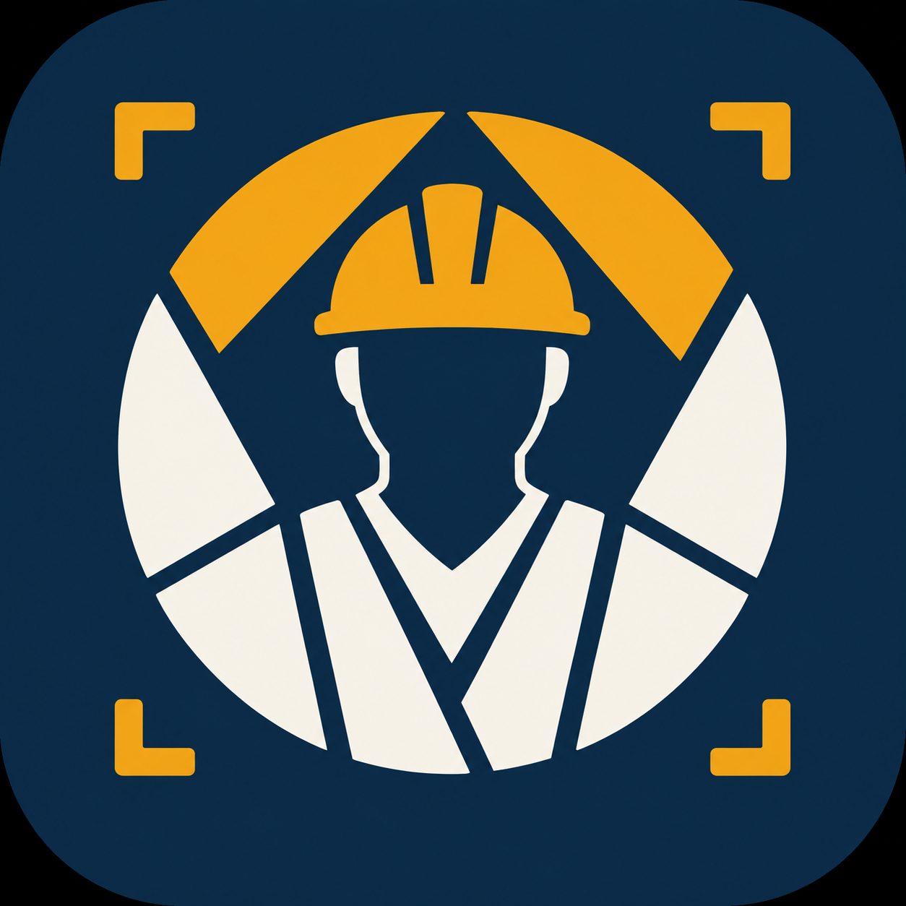
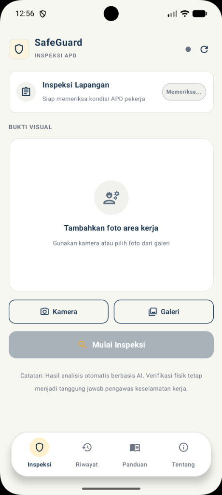
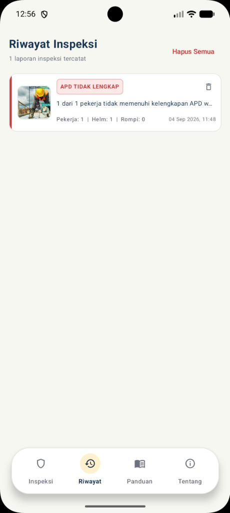
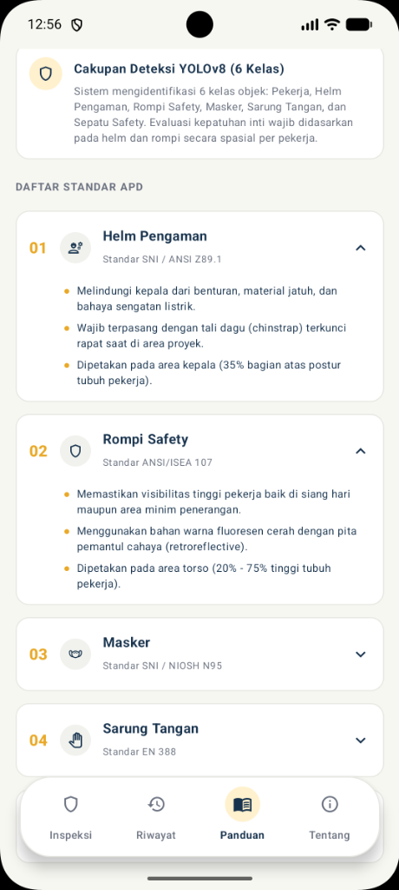

# SafeGuard K3 Inspector – Klasifikasi Kepatuhan Penggunaan APD Pekerja Berbasis Android Menggunakan YOLOv8

<p align="center">
  
</p>

Aplikasi Android modern berbasis **Jetpack Compose** terintegrasi dengan backend **FastAPI** dan model deep learning **YOLOv8** untuk mendeteksi objek APD pada pekerja konstruksi/industri serta mengklasifikasikan kepatuhan keselamatan kerja (K3) secara komprehensif.

---

## 🏗️ Konsep & Metodologi K3

> **Metode Teknis:** YOLOv8 digunakan untuk mendeteksi dan melokalisasi objek APD (Person, Hard_hat, Vest).  
> **Output Utama:** Klasifikasi kepatuhan penggunaan APD pekerja menjadi 4 status resmi K3 berdasarkan aturan spasial (posisi helm pada area kepala dan rompi pada area tubuh pekerja).

### 4 Kategori Status Kepatuhan K3:
1. 🟢 **APD LENGKAP**: Seluruh pekerja yang terdeteksi dalam frame menggunakan Helm Keselamatan (*Hard_hat*) dan Rompi Reflektif (*Vest*) secara bersamaan.
2. 🔴 **APD TIDAK LENGKAP**: Ditemukan minimal 1 pekerja yang tidak mengenakan helm, tidak mengenakan rompi, atau tidak mengenakan keduanya.
3. 🟠 **PERLU PEMERIKSAAN**: Ditemukan atribut APD (helm/rompi) tetapi pekerja tidak terdeteksi secara utuh (misalnya foto terlalu dekat, sudut terpotong, atau oklusi ekstrem).
4. ⚪ **TIDAK ADA PEKERJA**: Tidak ada manusia maupun atribut APD yang terdeteksi di dalam frame foto.

---

## Fitur Utama (Features)

Aplikasi dibangun dengan arsitektur modular Jetpack Compose menggunakan navigasi bawah (`NavigationBar`) dengan 4 menu utama:

### 1. 🔍 Inspeksi
* **Input Foto Fleksibel**: Ambil langsung menggunakan kamera perangkat (`TakePicture`) atau pilih foto resolusi penuh dari galeri (`ActivityResultContracts.PickVisualMedia`).
* **Kelola Foto**: Preview foto dengan tombol **Ganti Foto** dan **Hapus Foto**.
* **Optimalisasi Jaringan**: Kompresi dan penyesuaian skala gambar otomatis sebelum pengiriman ke backend untuk performa cepat dan hemat bandwidth.
* **Analisis & Deteksi YOLOv8**: Tombol analisis dengan progress indicator (input terkunci saat proses inferensi berlangsung).
* **Visualisasi Bounding Box**: Gambar hasil inferensi dilengkapi kotak deteksi warna K3 (Biru: Pekerja, Hijau: Helm, Oranye: Rompi) dan label persentase confidence.
* **Evaluasi Individual**: Menampilkan rincian kepatuhan per pekerja (Pekerja #1, Pekerja #2, dst).
* **Simpan Manual ke Riwayat**: Dilengkapi tombol eksplisit **"Simpan ke Riwayat"** (tanpa auto-save diam-diam) yang menyimpan metadata ke SQLite dan foto ke direktori privat aplikasi (`filesDir/inspections/`).

### 2. 📋 Riwayat
* **Daftar Catatan Persisten**: Menampilkan daftar seluruh inspeksi tersimpan di perangkat lokal offline.
* **Informasi Lengkap Item**: Thumbnail foto tersimpan, tanggal & jam inspeksi, badge status K3 dengan warna standar, ringkasan jumlah pekerja/helm/rompi, dan alasan evaluasi.
* **Navigasi Detail**: Klik item riwayat untuk membuka tampilan detail lengkap.
* **Hapus Aman**: Tombol hapus satuan dengan dialog konfirmasi (`AlertDialog`) untuk mencegah ketidaksengajaan. Opsi hapus semua riwayat juga tersedia.

### 3. 📄 Detail Riwayat
* Menampilkan foto hasil inspeksi utuh dari media internal aplikasi (tetap tersimpan meskipun aplikasi di-restart).
* Status kepatuhan lengkap beserta ringkasan metrik objek (Pekerja, Helm, Rompi).
* Rincian kepatuhan masing-masing pekerja.
* Penafian (*disclaimer*) resmi K3 terkait hasil analisis AI otomatis.

### 4. 📖 Panduan APD
* Panduan edukasi standar keselamatan K3 untuk **Helm Proyek (Hard Hat)** dan **Rompi Reflektif (Safety Vest)** sesuai regulasi SNI / ANSI.
* Penjelasan kriteria 4 status klasifikasi sistem.
* **Informasi Batasan Model**: Edukasi transparan bahwa sistem hanya mendeteksi Person, Hard Hat, dan Vest (tidak mengevaluasi masker, sarung tangan, atau safety boots karena keterbatasan kelas dataset pelatihan).

### 5. ℹ️ Tentang
* Informasi identitas sistem, metodologi YOLOv8, stack teknologi (Kotlin 2.2, Jetpack Compose, FastAPI, SQLite), dan penafian (disclaimer) kecerdasan buatan.

---

## Screenshot & Tampilan Aplikasi (Target: 3 Tangkapan Layar)

Berikut adalah dokumentasi visual antarmuka aplikasi Android **SafeGuard K3 Inspector**:

| 🔍 1. Inspeksi Lapangan | 📋 2. Riwayat Inspeksi | 📖 3. Panduan Standar APD K3 |
| :---: | :---: | :---: |
|  |  |  |
## 🎬 Skenario Demonstrasi Aplikasi (Live Demo Flow)

Untuk memvalidasi sistem secara *end-to-end* (Aplikasi Android Jetpack Compose $\leftrightarrow$ Backend FastAPI $\leftrightarrow$ Model YOLOv8):

1. **Persiapan Koneksi:**
   - Jalankan backend FastAPI pada port 8000: `uvicorn app:app --host 127.0.0.1 --port 8000`.
   - Hubungkan HP Android ke PC via USB debugging dan aktifkan reverse port: `adb reverse tcp:8000 tcp:8000`.
   - Buka aplikasi **SafeGuard K3 Inspector** di Android. Indikator backend di kanan atas akan berstatus *Server Siap*.

2. **Skenario 1 — Pengujian Kepatuhan Lengkap (🟢 APD Lengkap):**
   - Pada menu **Inspeksi Lapangan**, unggah/foto pekerja yang mengenakan helm dan rompi secara lengkap.
   - Tekan tombol **Mulai Inspeksi**.
   - Sistem menampilkan kotak deteksi warna (Biru: Pekerja, Hijau: Helm, Oranye: Rompi) serta badge status **🟢 APD LENGKAP**.

3. **Skenario 2 — Pengujian Pelanggaran APD (🔴 APD Tidak Lengkap):**
   - Unggah/foto pekerja di lapangan yang tidak memakai helm atau rompi.
   - Tekan tombol **Mulai Inspeksi**.
   - Sistem menandai dengan badge **🔴 APD TIDAK LENGKAP** beserta alasan evaluasi spesifik per pekerja.

4. **Skenario 3 — Penyimpanan Log Riwayat Offline:**
   - Tekan tombol simpan hasil inspeksi.
   - Buka menu **Riwayat** untuk memeriksa catatan inspeksi yang tersimpan persisten secara offline di SQLite perangkat.

---

## Instalasi & Cara Menjalankan (Step-by-Step)

Berikut panduan langkah demi langkah (step-by-step) untuk instalasi dan cara menjalankan backend serta aplikasi Android:

### Prasyarat Sistem (Prerequisites)
* Python 3.9+ dan pip
* JDK 17 / JBR (Java Development Kit)
* Android Studio / ADB (Android Debug Bridge)
* Perangkat Android fisik atau Emulator dengan opsi USB Debugging aktif

### Langkah 1: Instalasi & Cara Menjalankan Backend (FastAPI)
Pastikan dependensi Python terpasang:
```bash
cd d:/Klasifikasi-APD-K3
pip install -r requirements.txt
```

Jalankan server pengembangan FastAPI:
```bash
uvicorn app:app --host 127.0.0.1 --port 8000 --reload
```

Verifikasi endpoint di browser:
* Cek status server: [http://127.0.0.1:8000/health](http://127.0.0.1:8000/health)
* Dokumentasi Swagger: [http://127.0.0.1:8000/docs](http://127.0.0.1:8000/docs)

### Langkah 2: Menghubungkan Emulator/HP Android ke Backend Lokal
Hubungkan port 8000 perangkat Android ke server lokal menggunakan ADB:
```bash
adb reverse tcp:8000 tcp:8000
```
*(Dengan ADB Reverse, aplikasi Android dapat mengakses `http://127.0.0.1:8000/predict` secara langsung).*

### Langkah 3: Build & Instalasi Aplikasi Android (APK)
Proyek Android berada di: `D:\AndroidProjects\SafeGuardK3`

Untuk melakukan kompilasi dan perakitan APK:
```powershell
$env:JAVA_HOME="D:\AND\jbr"; $env:PATH="D:\AND\jbr\bin;" + $env:PATH
cd D:\AndroidProjects\SafeGuardK3
.\gradlew.bat assembleDebug
```

File APK siap pakai berlokasi di:
```
D:\AndroidProjects\SafeGuardK3\app\build\outputs\apk\debug\app-debug.apk
```
Pasang APK ke HP/Emulator menggunakan ADB:
```bash
adb install -r D:\AndroidProjects\SafeGuardK3\app\build\outputs\apk\debug\app-debug.apk
```

---

## 📦 Dataset & Bobot Model YOLOv8
* File model pre-trained: `best.pt` (berada di root repositori backend).
* Unduhan Dataset & Artifacts: [Google Drive Link](https://drive.google.com/file/d/14fpEcvpy2v0ukh_qp0mIfvq6lEaq0RVm/view?usp=sharing)
